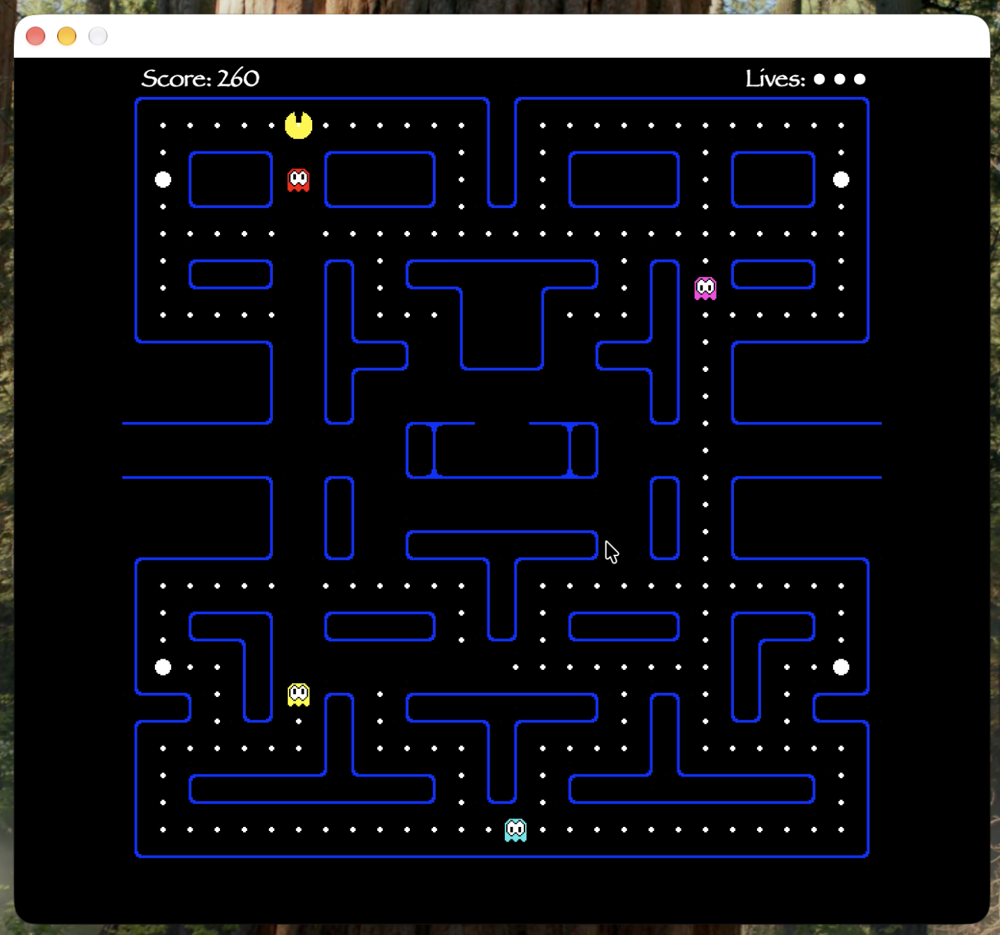
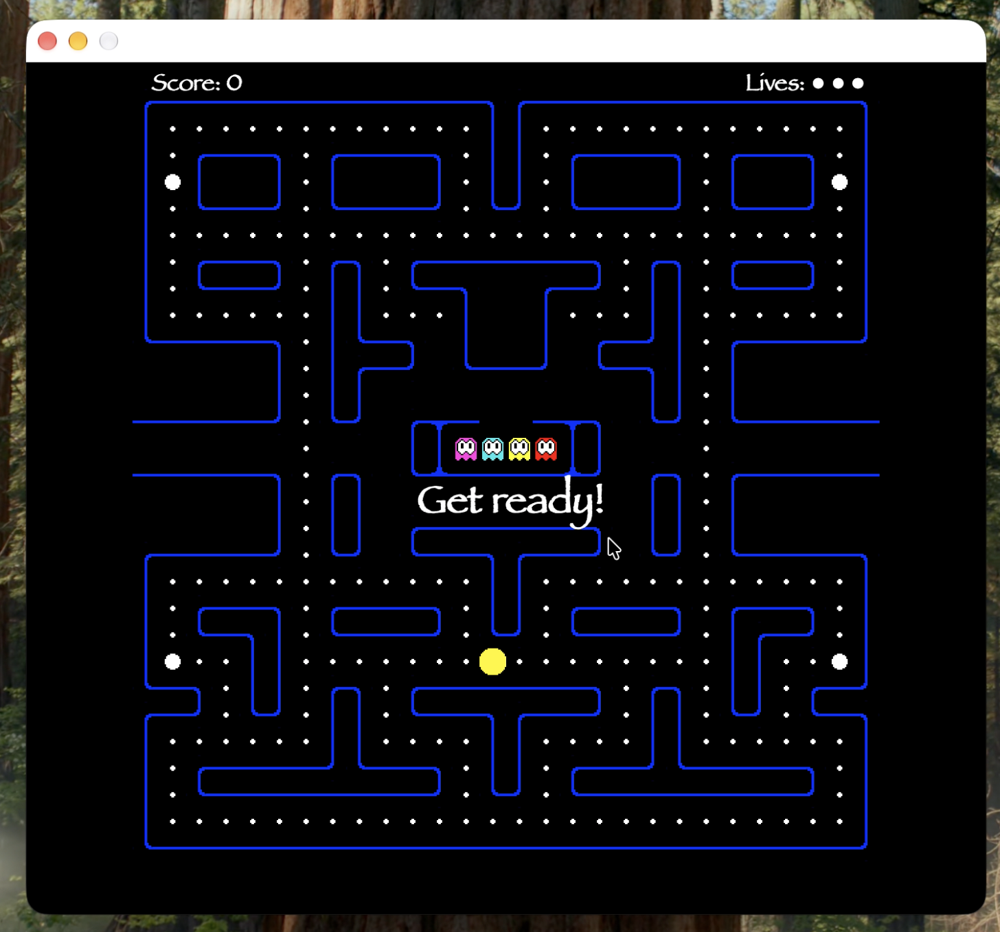
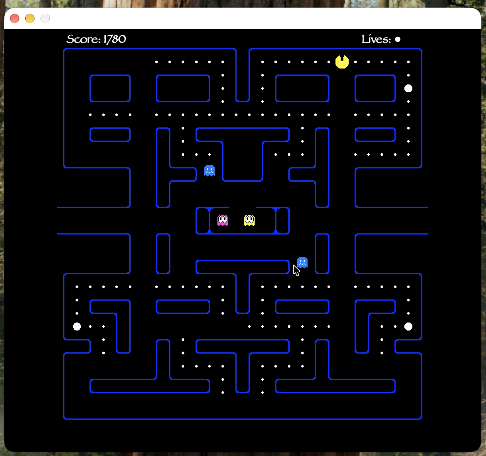
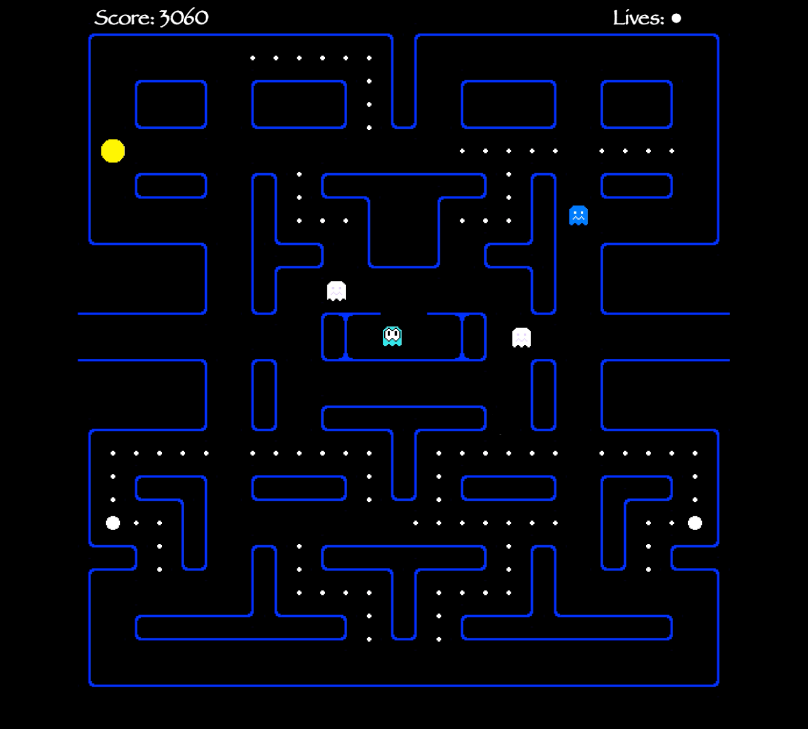
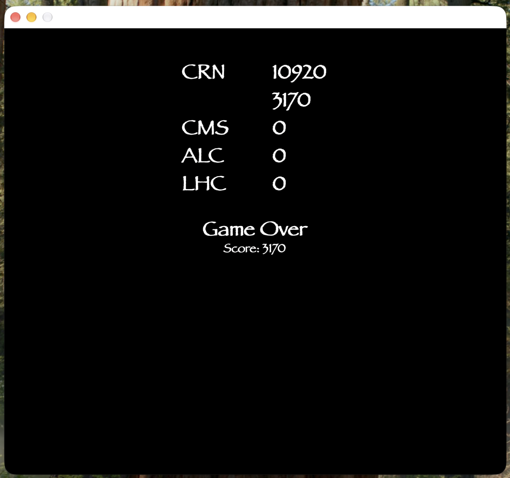

# VUB Pacman

A clone of the classic Pac-Man arcade game, written in C++ with Qt in 2016 for the Object Oriented Programming in Physics course at the Vrije Universiteit Brussel (VUB). The board, the characters and the highscore table are all drawn with Qt's graphics view framework, and the original arcade sound effects play during the game.



## What it does

- **Gameplay:** click Play and steer Pac-Man with the arrow keys. Every peg is worth 10 points and every power pellet 100. Pac-Man starts with three lives. The tunnels at the left and right of the board wrap around to the other side.
- **Ghosts:** four ghosts (pink, blue, yellow and red) leave the ghost house and alternate between scatter and chase phases. Touching a ghost costs a life.
- **Power pellets:** eating one of the four large pellets turns the ghosts blue for six seconds. They start flashing white just before they recover. Eating a scared ghost sends it back to the ghost house and scores 200, 400, 800 and then 1200 points.
- **Levels:** clearing the board moves on to the next level. Each level shortens the scatter phases and lengthens the chase phases.
- **Game over:** after the last life the highscore table is shown. A score that makes the top five can be saved with a name.

| Get ready | Scared ghosts | Scared ghosts ending |
|---|---|---|
|  |  |  |



## How it works

An overview of every class and its methods is in [classView.pdf](docs/classView.pdf). In short:

- `Game` is a `QGraphicsView` that owns the scene, the level, the player, the ghosts, the score and the lives. It handles starting a new game, clearing a level, dying and the highscore table.
- `Level` reads a board from a CSV file and builds it out of `Tile` objects. Each tile knows its image and whether it is a wall.
- `MovingObject` is an abstract base class for everything that moves over the board, with timers for movement and animation. `Player` and `Ghost` inherit from it.
- `Player` reacts to the arrow keys, eats pegs and power pellets, and plays its death animation.
- `Ghost` switches between scatter, chase, scared and dead states on timers, and picks a direction at every intersection.
- `Score` and `Health` are the score and lives shown at the top of the screen.

The images, sounds and levels are compiled into the executable as Qt resources (`resources/resources.qrc`).

### Level editor

Boards are 36 by 32 grids of characters stored in `resources/levels`. They can be designed in the spreadsheet [levelEditor.xlsx](docs/levelEditor.xlsx), which colours every cell by its type, and exported to CSV. [levelEditorReadMe.pdf](docs/levelEditorReadMe.pdf) lists the characters: `e` is an empty tile, `.` a peg, `*` a power pellet, and the other letters are wall pieces.

## Running it

Requires Qt 5 with the Multimedia module (it was written with Qt 5.11). Open `Pacman.pro` in Qt Creator and press Run, or build it from the command line:

```sh
qmake Pacman.pro
make
```

The highscore table is read from `highscores.csv` in the working directory.

## License

BSD 3-Clause, see [LICENSE](LICENSE). The license covers the code in this repository. Pac-Man, its character designs and its original sound effects are trademarks and property of Bandai Namco Entertainment and are not covered by this license.
